# RappoLink · Autoevaluación de pantallas obligatorias

Autoevaluación de las **pantallas obligatorias** de la app **RappoLink**: para cada pantalla se describe qué debe hacer y se muestra la evidencia de la app funcionando.

| | |
|---|---|
| **Equipo** | Cristopher Gerardo Villanueva Ramírez · Ángel Gerardo Méndez Cervantes |
| **Materia** | Desarrollo de Aplicaciones Móviles |
| **Tarea** | 12 |
| **Entrega** | [PDF de pantallas obligatorias](<Pantallas-Obligatorias-App-RappoLink Christopher Gerardo Villanueva Ramírez-Ángel Gerardo Méndez Cervantes (1).pdf>) |
| **App** | [Código de RappoLink (Tarea 9)](https://github.com/1225100392cgvr-cell/-Implementaci-n-de-vista-para-proyecto) |

## Secciones 1 a 5 (páginas 1 a 14 del PDF)

Splash, acceso, dashboards, usuarios y roles.

<table>
  <tr><td align="center"> Página 1</td><td align="center"> Página 2</td><td align="center"> Página 3</td></tr>
  <tr><td align="center"> Página 4</td><td align="center"> Página 5</td><td align="center"> Página 6</td></tr>
  <tr><td align="center"> Página 7</td><td align="center"> Página 8</td><td align="center"> Página 9</td></tr>
  <tr><td align="center"> Página 10</td><td align="center"> Página 11</td><td align="center"> Página 12</td></tr>
  <tr><td align="center"> Página 13</td><td align="center"> Página 14</td></tr>
</table>

## Secciones 6 a 15: capturas de la app funcionando

> A partir de la página 15 del PDF, las imágenes no quedaron guardadas en el archivo (se ven como un recuadro gris con ⚠️). Estas capturas se tomaron directamente de la app RappoLink.

### 6. Grupos
<table>
  <tr><td align="center">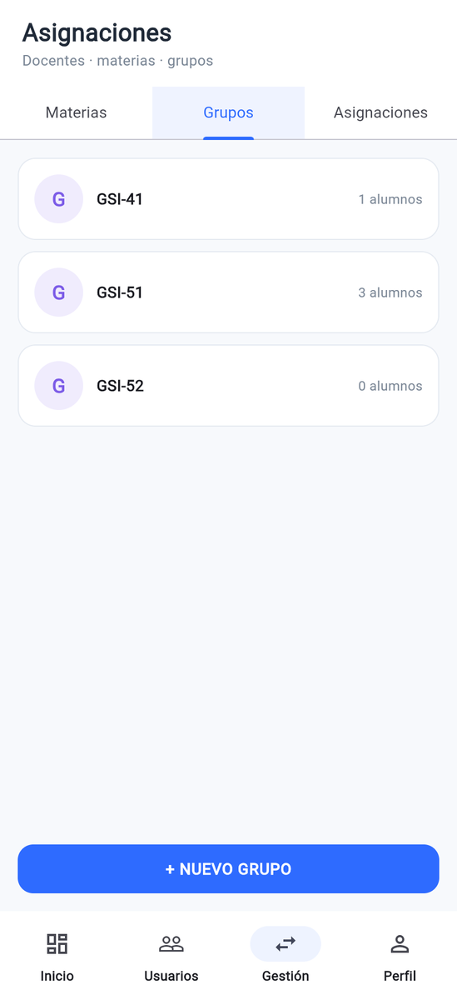 Lista de grupos</td><td align="center">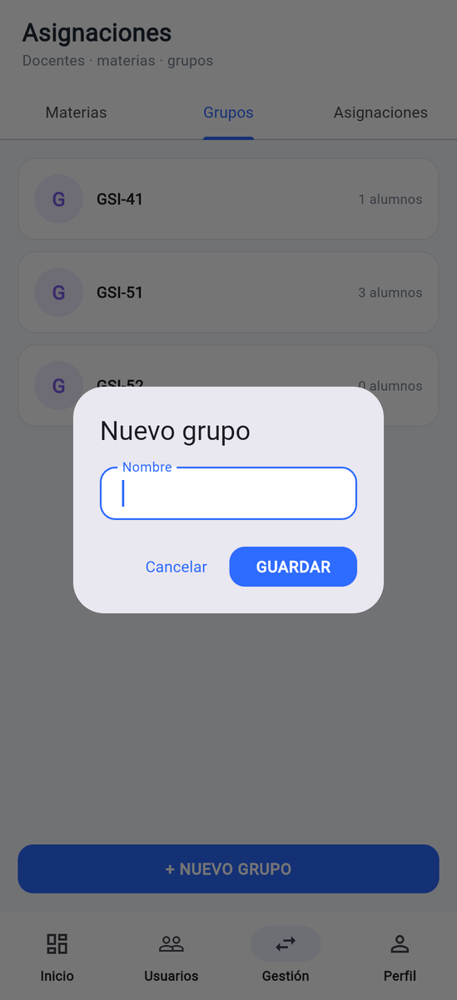 Formulario de grupo</td></tr>
</table>

### 7. Materias
<table>
  <tr><td align="center">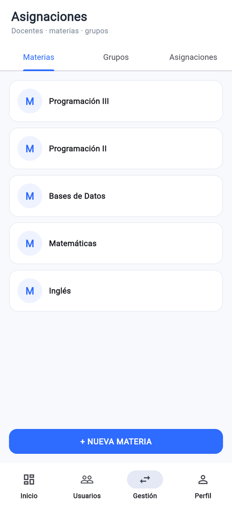 Lista de materias</td><td align="center">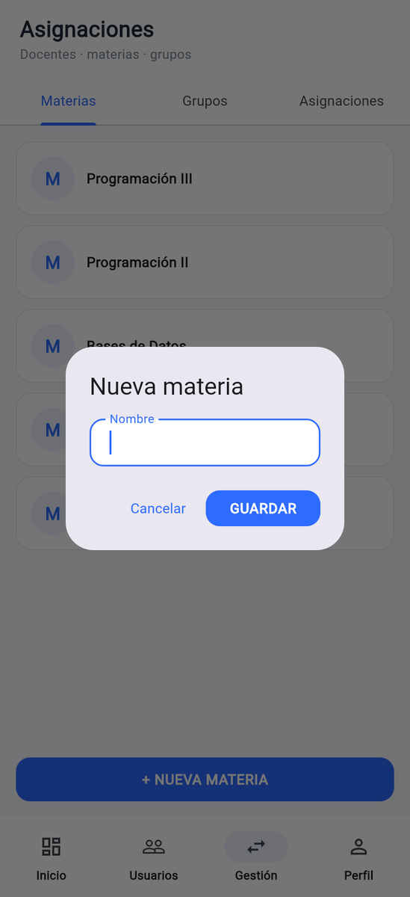 Formulario de materia</td></tr>
</table>

### 8. Inscripciones

La app todavía no tiene una pantalla de inscripciones; el número de alumnos inscritos aparece en la **lista de grupos** (sección 6).

### 9. Asignaciones
<table>
  <tr><td align="center">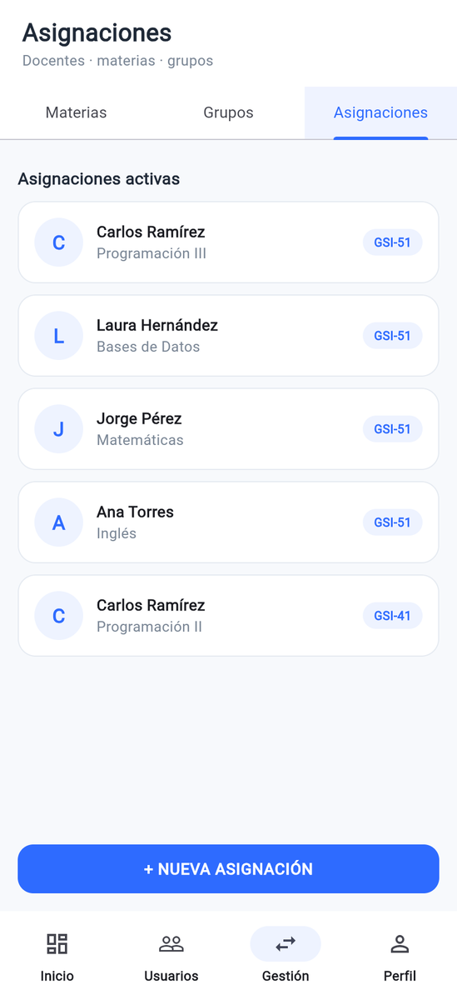 Lista de asignaciones</td><td align="center">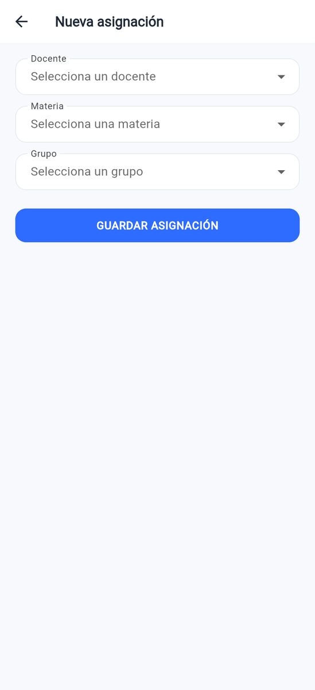 Formulario de asignación</td></tr>
</table>

### 10. Conversaciones
<table>
  <tr><td align="center">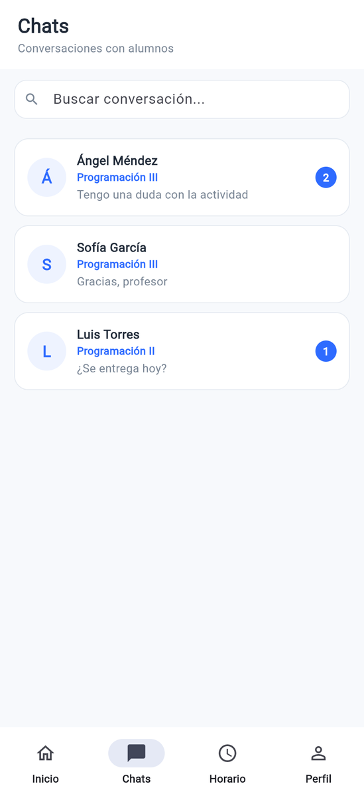 Lista de conversaciones (Docente)</td><td align="center"> Lista de conversaciones (Alumno)</td><td align="center">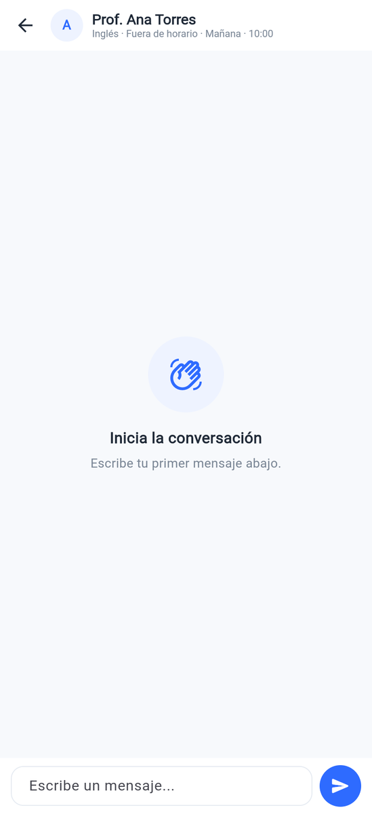 Iniciar conversación</td></tr>
  <tr><td align="center">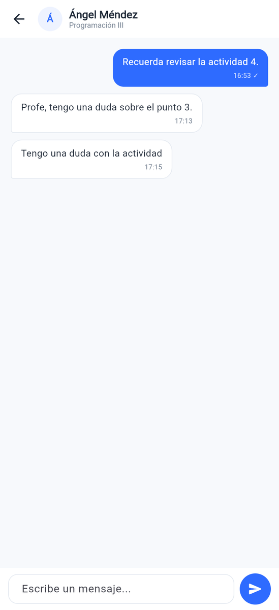 Detalle de conversación</td></tr>
</table>

### 11. Mensajes
<table>
  <tr><td align="center">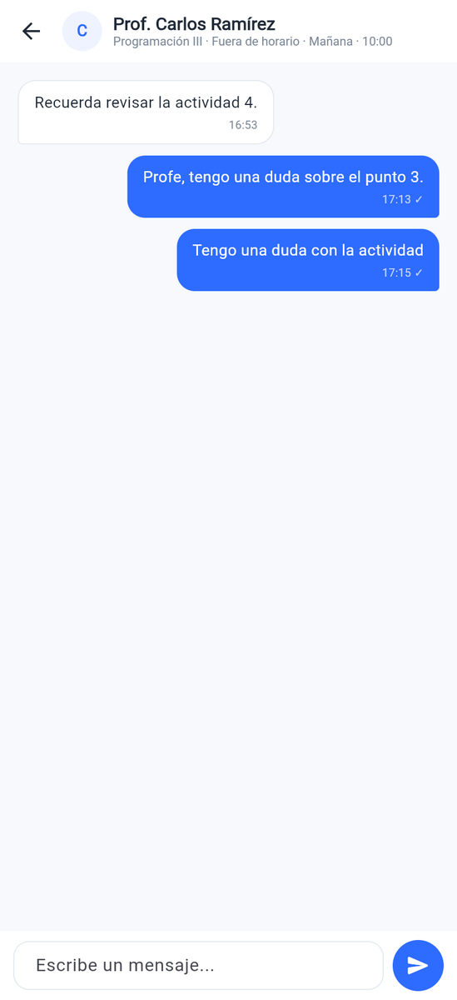 Pantalla de chat</td></tr>
</table>

### 12. Mensajes programados
<table>
  <tr><td align="center">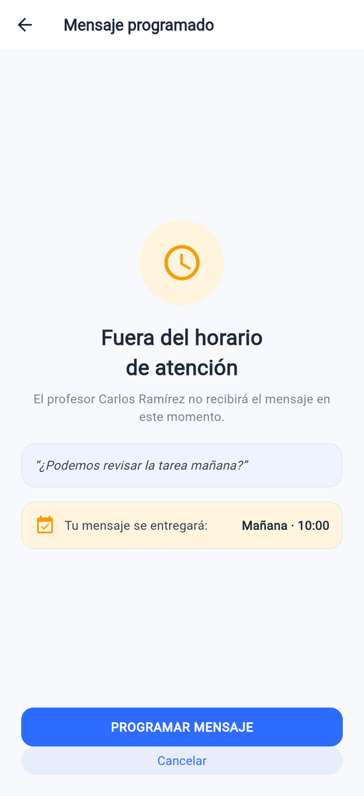 Formulario de programación</td><td align="center">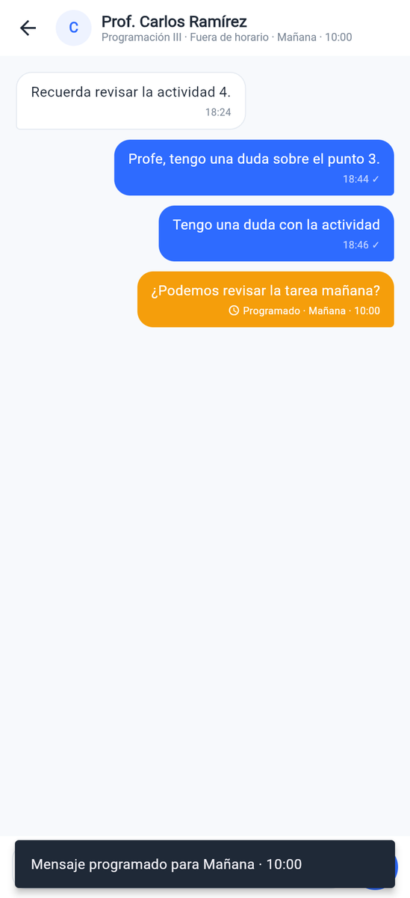 Mensaje programado en el chat</td></tr>
</table>

### 13. Horarios de atención
<table>
  <tr><td align="center">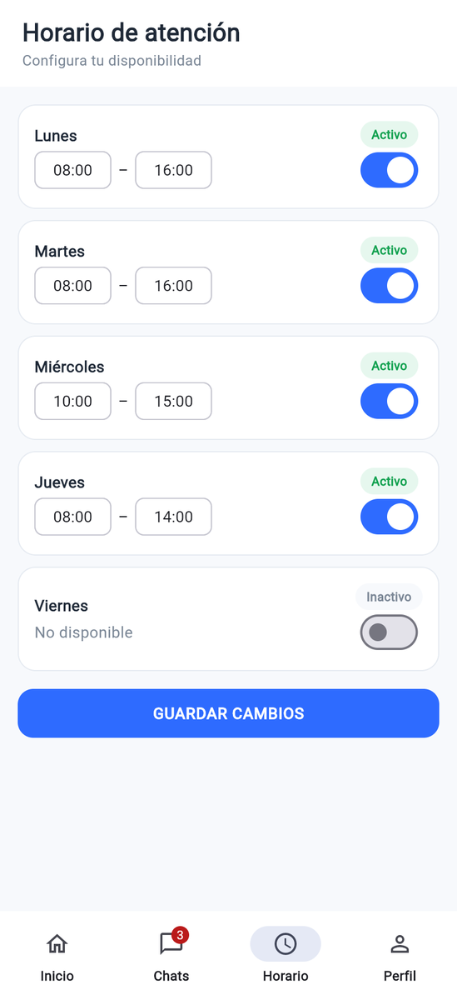 Lista y formulario de horarios</td></tr>
</table>

### 14. Notificaciones (opcional)

No implementada en esta versión de la app.

### 15. Navegación mínima
<table>
  <tr><td align="center">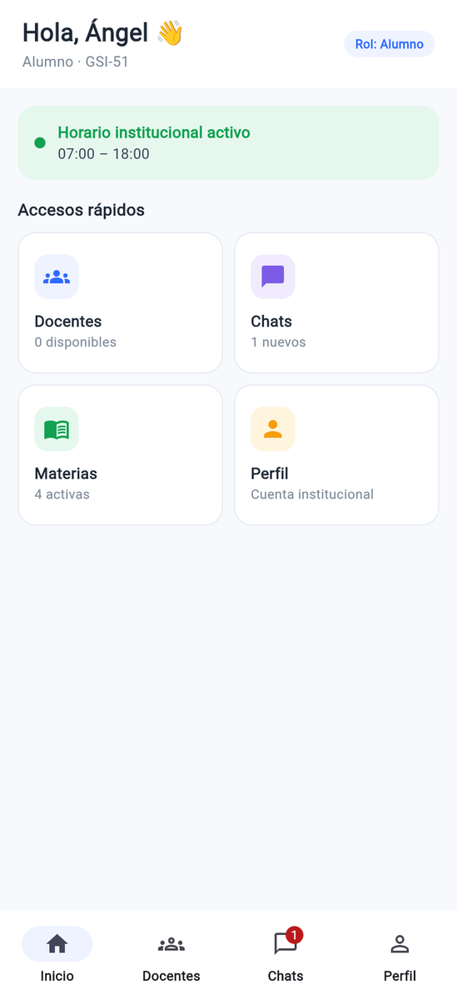 Alumno</td><td align="center">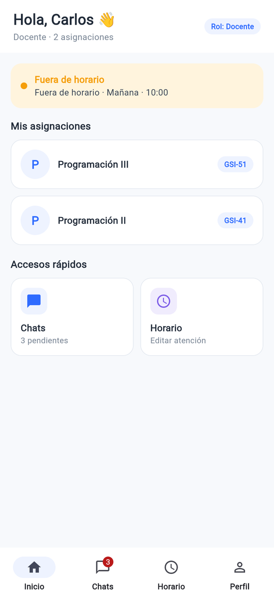 Docente</td><td align="center">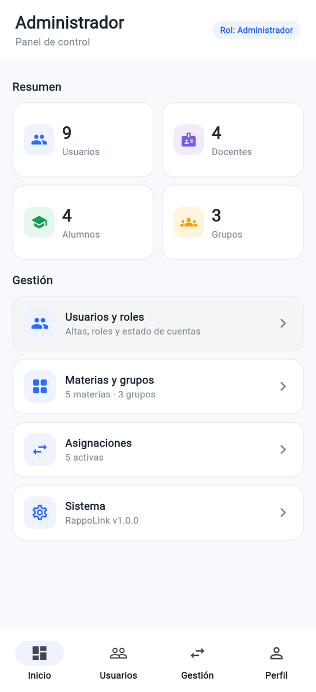 Administrador</td></tr>
</table>

## Páginas 15 a 36 del PDF

Ver las páginas con la descripción de cada pantalla (sin las imágenes)

<table>
  <tr><td align="center"> Página 15</td><td align="center"> Página 16</td><td align="center"> Página 17</td></tr>
  <tr><td align="center"> Página 18</td><td align="center"> Página 19</td><td align="center"> Página 20</td></tr>
  <tr><td align="center"> Página 21</td><td align="center"> Página 22</td><td align="center"> Página 23</td></tr>
  <tr><td align="center"> Página 24</td><td align="center"> Página 25</td><td align="center"> Página 26</td></tr>
  <tr><td align="center"> Página 27</td><td align="center"> Página 28</td><td align="center"> Página 29</td></tr>
  <tr><td align="center"> Página 30</td><td align="center"> Página 31</td><td align="center"> Página 32</td></tr>
  <tr><td align="center"> Página 33</td><td align="center"> Página 34</td><td align="center"> Página 35</td></tr>
  <tr><td align="center"> Página 36</td></tr>
</table>

